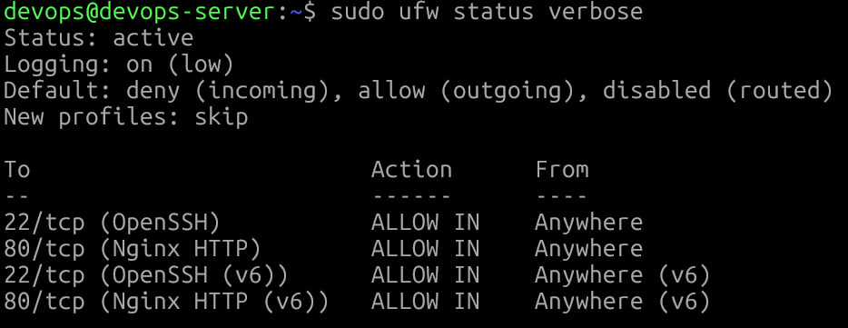
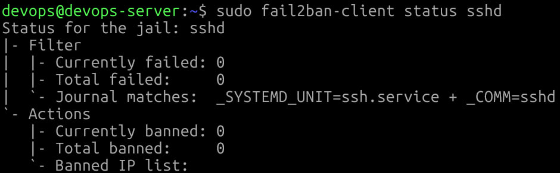
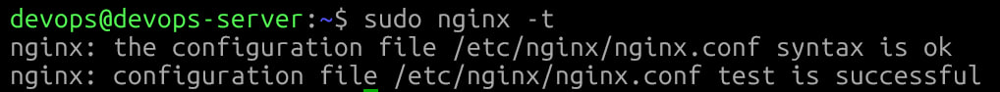
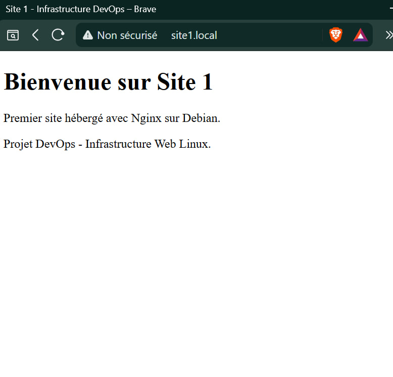
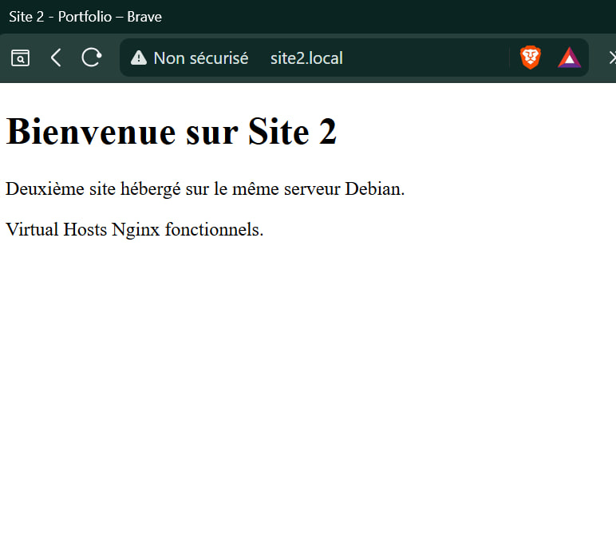
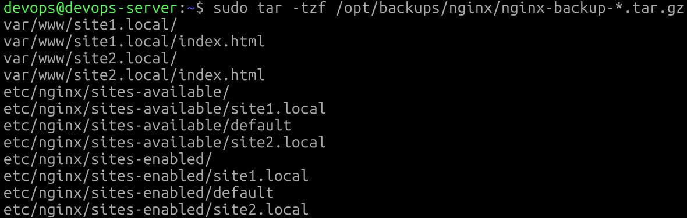
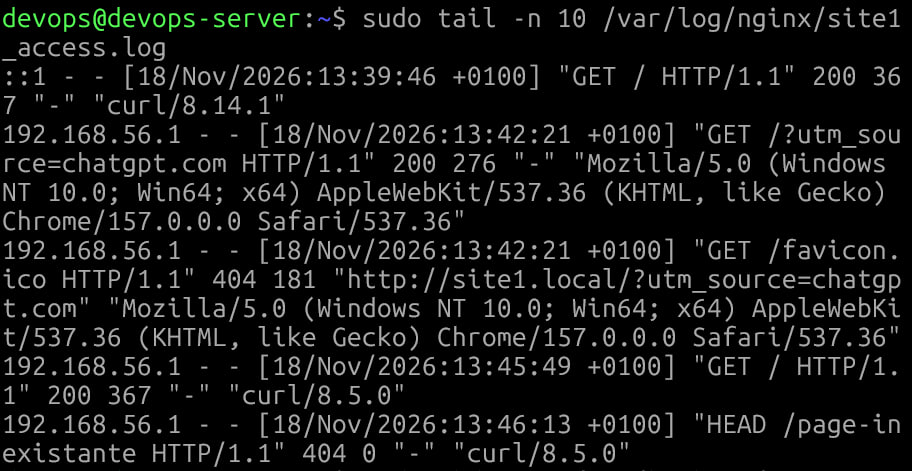
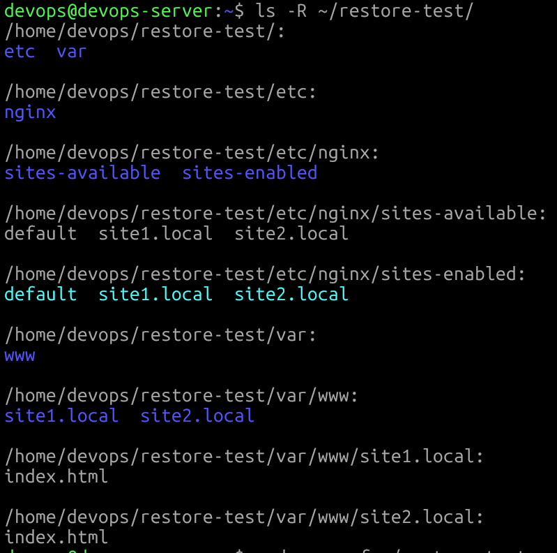

# Projet 1 — Infrastructure Web Linux

## 1. Présentation

Mise en place d'une infrastructure web sur un serveur Debian.
L'objectif est d'administrer et de sécuriser un serveur Linux capable
d'héberger plusieurs sites web.

## 2. Environnement technique

- OS : Debian Server
- Serveur web : Nginx
- Accès distant : OpenSSH
- Pare-feu : UFW
- Protection SSH : Fail2ban
- Automatisation : Bash et Cron
- Virtualisation : VirtualBox

## 3. Architecture

- Serveur Debian avec deux interfaces réseau.
- Accès SSH depuis WSL2 Ubuntu.
- Deux sites web hébergés sur le même serveur :
  - site1.local
  - site2.local

## 4. Sécurisation du serveur

- Connexion SSH par clé publique.
- Connexion SSH par mot de passe désactivée.
- Connexion SSH directe en root interdite.
- Pare-feu UFW actif.
- Protection contre les tentatives de connexion SSH avec Fail2ban.

## 5. Configuration Nginx

- Installation et activation de Nginx.
- Création de deux Virtual Hosts.
- Séparation des fichiers de chaque site.
- Configuration des journaux d'accès et d'erreurs.

## 6. Automatisation des sauvegardes

- Script Bash de sauvegarde.
- Archivage des sites et configurations Nginx.
- Suppression automatique des anciennes sauvegardes.
- Planification quotidienne avec Cron.
- Test de restauration des archives.

## 7. Vérifications

- Accès SSH fonctionnel.
- Pare-feu actif.
- Fail2ban actif.
- Deux sites accessibles depuis le navigateur.
- Journaux Nginx opérationnels.
- Sauvegarde et restauration validées.

## 8. Compétences acquises

- Administration Linux.
- Gestion des utilisateurs et permissions.
- Administration SSH.
- Configuration réseau.
- Sécurisation d'un serveur.
- Administration Nginx.
- Gestion des Virtual Hosts.
- Analyse des logs.
- Automatisation Bash.
- Planification Cron.
- Sauvegarde et restauration.

## 9. Captures d'écran

### Pare-feu UFW

### Protection SSH avec Fail2ban

### Configuration Nginx

### Site 1

### Site 2

### Sauvegardes

### Logs

### restore tests

